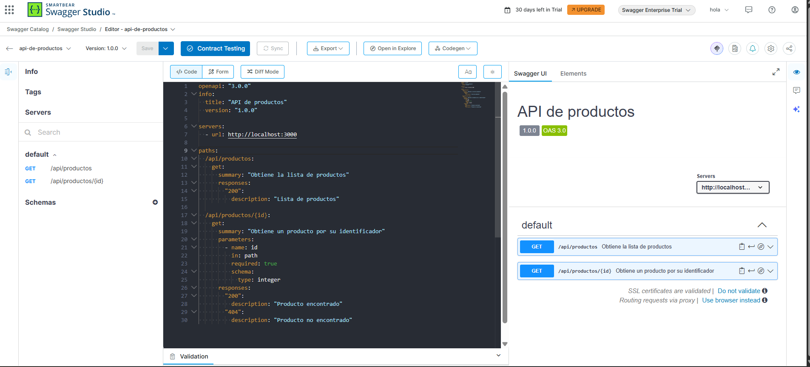

#  API

**1. ¿Qué es OpenAPI?**
OpenAPI es una especificación estándar e independiente del lenguaje que permite describir formalmente el comportamiento de una API REST (rutas, métodos, parámetros y respuestas).

**2. ¿Para qué sirve Swagger UI?**
Es una herramienta que transforma un documento OpenAPI en una página web visual e interactiva, facilitando la lectura de la documentación y permitiendo probar los endpoints directamente desde el navegador.

**3. Descripción de los endpoints**
- `GET /api/productos`: Devuelve la lista completa de productos almacenados.
- `GET /api/productos/{id}`: Devuelve la información de un producto específico buscándolo por su identificador.

**4. Captura de la documentación visualizada**

