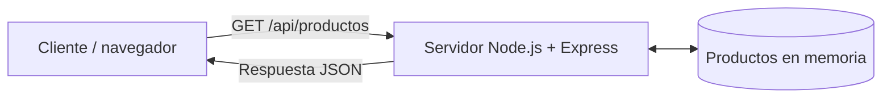

# Arquitectura

## Diagrama

    
### Explicación:

El cliente mediante la peticion GET/api/productos pide al servidor node que le envie todos los productos listados, el servidor comproueba los productos en memoria y devuelve un archivo .json de los productos.

### Reflexiona:

* ¿Qué cambiaría en la arquitectura si los productos estuvieran almacenados en una
base de datos?

Pues cambiaria el paso de una vez llega al servidor node en vez de revisar los productos en su memoria mandaria una peticion a la BD y la base de datos le devolveria el archivo .json por lo que el servidor solo actuaria de intermediario.

